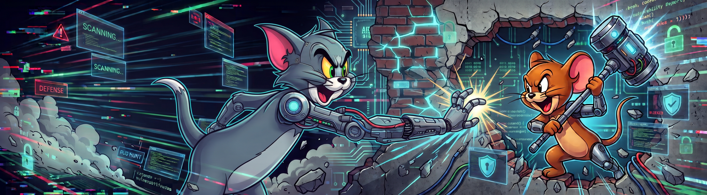

# Tom & Jerry



Open-source, LLM-driven dynamic security testing for **your own** web applications. Point it at a
running app and two Claude-driven agents work it over:

- **Tom** drives a real Chromium browser — navigating, filling forms, intercepting and mutating
  requests — to find vulnerabilities, and confirms each one by observation.
- **Jerry** watches Tom's every move, triages each confirmed finding, and reasons about how far a
  normal user could escalate it.

It is language-agnostic: it tests the running app through the browser and HTTP, so it does not
care whether the target is Next.js, Laravel, Rails, or anything else.

> **Authorized testing only.** Run this against systems you own or are explicitly permitted to
> test. The scope allowlist is the authorization boundary — any request outside it is blocked
> before it leaves the browser.

## How it works

Tom attacks from a community-documented **playbook** per vulnerability class (where the flaw shows
up, which techniques to try, which payloads). A finding is only recorded when a deterministic
**oracle** proves it — e.g. a reflected-XSS payload that actually executes in the page — so there
are no guesses. Everything Tom does and every confirmed finding is streamed to Jerry and written
to `reports/<runId>/` (`events.jsonl`, `findings.jsonl`, and a human-readable `report.md`).

## Prerequisites

- **Docker** (the only hard requirement — the image bundles Chromium and its system libraries).
- An **Anthropic API key** (`ANTHROPIC_API_KEY`), since Tom and Jerry run on the Claude API.
- A running app to test.

```bash
cp .env.example .env        # then set ANTHROPIC_API_KEY
```

## Run it — from Claude Code (recommended)

**Open the Claude Code session in the root of the application you are going to scan.** The scan
itself is black-box (it only reaches the app over the network), but the remediation step edits
source code, so it uses the session's working directory as the target repository. With the session
rooted in the target app, that path is detected automatically — nothing to configure.

Launch a scan with the slash command, passing the frontend **port**:

```
/tom-and-jerry 3000
```

A bare port resolves to your machine's **LAN IP** (`http://<lan-ip>:3000`), so the app is hit as a
real network client would reach it. The command locks the scan's scope to that single host, runs
it in Docker, and summarizes the report when it finishes. Other forms:

```
/tom-and-jerry 192.168.0.10:3000      # explicit host:port
/tom-and-jerry http://localhost:3000   # full URL (localhost → host.docker.internal)
/tom-and-jerry                         # uses TJ_FRONTEND_URL from .env
```

## Run it — Docker directly

```bash
docker compose run --rm --build --name tom-and-jerry tom-and-jerry \
  pnpm dev -- --frontend=http://192.168.0.10:3000 --scope=192.168.0.10
```

From inside the container the host machine is reachable as **`host.docker.internal`** — use it
instead of `localhost` for an app running locally, and keep that host in scope. The browser runs
headless in Docker; reports land in `./reports` on the host via a bind mount.

## Run it — natively (to watch the browser)

Requires Node, pnpm, and a one-time browser install on the host. This runs headful so you can see
Tom clicking through the app:

```bash
pnpm install
pnpm exec playwright install chromium
pnpm dev -- --frontend=http://192.168.0.10:3000
```

## Configuration

Defaults live in `.env` (see `.env.example`); every run can override them with flags:

| Flag          | Meaning                                   | Example                             |
| ------------- | ----------------------------------------- | ----------------------------------- |
| `--frontend`  | Frontend target URL                       | `--frontend=http://192.168.0.10:3000` |
| `--backend`   | Backend target URL                        | `--backend=http://localhost:9000`   |
| `--scope`     | Comma-separated hosts allowed to be hit   | `--scope=192.168.0.10,localhost`    |
| `--max-steps` | Cap on Tom's actions                      | `--max-steps=60`                    |
| `--headless`  | Force headless (native run)               | `--headless=true`                   |

The targets' hosts are always in scope; anything else must be added to `--scope` / `TJ_SCOPE_HOSTS`
explicitly, or the request is blocked.

## Remediation

Finding a vulnerability is only half the job — Tom & Jerry also helps fix it. For every confirmed
finding, Jerry writes a **remediation plan** to `reports/<runId>/remediation.md`: the vulnerable
URL and payload, and the concrete code-level fix a developer should apply (parameterized queries
for SQLi, contextual output encoding and a CSP for reflected XSS, and so on).

Because the scan is black-box, Jerry does not know which source file is at fault — that is why the
fix step runs **from the target application's repository**, where the code lives:

1. Keep (or reopen) the Claude Code session in the **root of the scanned app**.
2. Run `/tom-and-jerry-fix` — it reads the newest run's `remediation.md`, locates the vulnerable
   code in the repo, and applies each fix, verifying with the repo's own gates.
3. It **never commits on its own.** When the fixes are in place it shows the diff and asks whether
   to commit — that decision is always the user's.

## Status

The engine, the Tom↔Jerry pipeline, the **reflected-XSS** and **SQL-injection** modules, and the
remediation handoff are complete end-to-end. Authenticated login as a normal user, plus **IDOR**
and **authorization / privilege-escalation** modules, are the next milestones.
